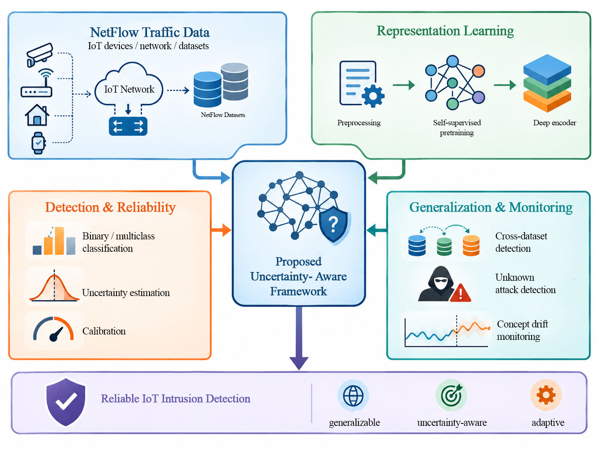

# Uncertainty-Aware IoT Intrusion Detection

Joint research by **[Siavash Partonia](https://github.com/partomahsiavash)** and **[Fardin Rahmanpour](https://github.com/fardinrahmnpour)**.

Research artifacts for evaluating how reliably a NetFlow intrusion detector performs across datasets, on unseen attack families, and under changes in network traffic.

**[Results workbook](Security_AI_Complete_Results.xlsx)** · **[Run the experiments](REPRODUCE.md)** · **[Get the datasets](DATASETS.md)** · **[Browse the Python source](security_iot_uncertainty_pipeline.py)** · **[Download the full artifact bundle](iot-ids-research-artifacts.zip)**

The pipeline combines masked tabular representation learning, supervised classification, uncertainty estimation, probability calibration, open-set evaluation, and temporal monitoring. The study tests whether high detection scores on familiar traffic carry over to different datasets and operating conditions.

## Results at a glance

Proposed model, mean Macro-F1 across the three standard-profile seeds.

| Evaluation | Binary | Multiclass |
| --- | ---: | ---: |
| Within NF-ToN-IoT-v1 | **0.9930** | 0.8066 |
| Within NF-BoT-IoT-v1 | **0.9121** | 0.6741 |
| NF-ToN-IoT-v1 → NF-BoT-IoT-v1 | 0.5549 | 0.3258 |
| NF-BoT-IoT-v1 → NF-ToN-IoT-v1 | 0.8105 | 0.2369 |

| Reliability check | Observed result |
| --- | --- |
| Unknown Injection | Composite AUROC **0.7416**, recall **0.0882** at the selected threshold |
| Unknown Reconnaissance | Composite AUROC **0.6699**, recall **0.0649** at the selected threshold |
| Binary probability calibration | ECE after temperature scaling **0.0017** on ToN-v1 and **0.0051** on BoT-v1 |
| Binary conformal coverage | Empirical coverage **0.681** on ToN-v1 and **0.528** on BoT-v1 against a nominal **0.90** |
| Temporal adaptation | Mean Macro-F1 **0.9480 → 0.9551** with 2,048 labeled samples. The starting score already exceeded the recovery target. |

The conformal procedure needs revalidation because the calibration and test stages compute nonconformity differently. PSI tracks feature-distribution changes, and Page–Hinkley uses prediction errors that require labels. The monitoring results establish changes in the evaluated streams and leave the question of label-free concept-drift detection open.

## Review the evidence

| Artifact | Where to start |
| --- | --- |
| [Results workbook](Security_AI_Complete_Results.xlsx) | `Main_Results` for per-seed comparisons, `Confidence_Intervals` for uncertainty, and `Calibration`, `Conformal`, and `Open_Set` for reliability |
| [Comparative results figure](results-overview.png) | Model comparison, ablation, and input perturbation summary |
| [Full artifact bundle](iot-ids-research-artifacts.zip) | Python source, workbook, 10 figures, 24 PyTorch checkpoints, run configuration, and execution log |
| [Reproduction guide](REPRODUCE.md) | Dependencies, a synthetic smoke test, the standard run command, and expected output locations |
| [Dataset records](DATASETS.md) | University of Queensland downloads, original and sampled counts, CSV filenames, and file checksums |

The archived run used the `standard` profile on CPU with seeds `17`, `42`, and `71`. Dataset packages are available from the original publisher under its reuse terms.
